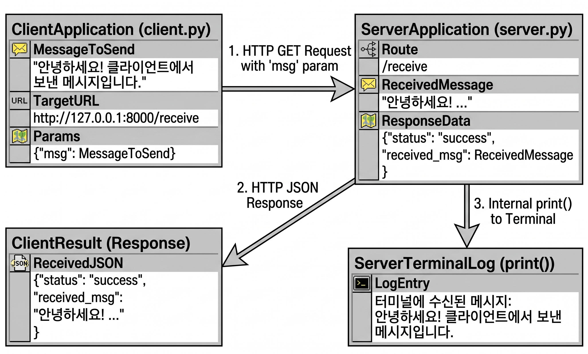

# FaskAPI로 Ontology 구현 해보기

Ontology구현에 앞서 간단한 RDB(Relational Database)를 먼저 구현해봅니다

## 환경설정

```bash
uv add fastapi uvicorn
```

## 서버 실행

```bash
uvicorn main:app --reload
```

## server-client 구현

### Step 1 : 서버 실행(첫 번째 터미널)

서버를 먼저 띄워서 클라이언트의 요청 대기

```bash
uvicorn server:app --reload
```

### Step 2 : 클라이언트 실행 (두 번째 터미널)

새 터미널 창을 열고 클라이언트 파일을 실행하여 메시지 전송

```bash
python client.py
```

